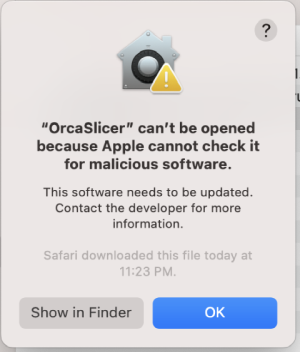
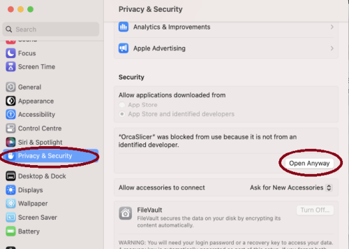

<div align="center">

<picture>
  
</picture>

[](https://github.com/Unlayered3D/Unlayered-Slicer/actions/workflows/build_all.yml)

**Unlayered Slicer**: the slicer for Unlayered 3D printers, with non-planar, multi-axis printing built in.

</div>

# Official links

- **Website:** <https://unlayered3d.com/slicer/>
- **Downloads:** <https://unlayered3d.com/slicer/download>
- **Source and issues:** <https://github.com/Unlayered3D/Unlayered-Slicer>

# What it is

Unlayered Slicer is Unlayered 3D's fork of [OrcaSlicer](https://github.com/OrcaSlicer/OrcaSlicer). On top of the OrcaSlicer feature set it adds:

- **Non-planar printing.** Split a model with cut planes and slice each chunk on its own tilted plane, so overhangs print without support and surfaces follow the part.
- **Multi-planar supports.** Support generation that follows the cut-plane geometry instead of assuming a flat bed.
- **Printer firmware and configuration bundled with the release**, with in-app update checks for the slicer, the firmware and the printer configuration.
- **Unlayered 3D printer profiles**, plus the printer, filament and process profiles inherited from OrcaSlicer.

Everything else you know from OrcaSlicer is still here: calibration tools, precise wall and seam control, adaptive layer heights, tree supports, multi-material printing and network printing through Klipper, PrusaLink, OctoPrint and others.

# Download

Stable and pre-release builds are published on the [releases page](https://github.com/Unlayered3D/Unlayered-Slicer/releases) and on <https://unlayered3d.com/slicer/download>. The application checks for updates itself and offers to install them.

# How to install

## Windows

Download the Windows installer for your CPU (`x64` or `arm64`) from the releases page and run it. A portable build is also published.

If the application fails to start, install the runtimes it depends on:

- [Microsoft Edge WebView2 Runtime](https://aka.ms/webview2)
- [Visual C++ Redistributable 2019 (x64)](https://aka.ms/vs/17/release/vc_redist.x64.exe)

## macOS

1. Download the universal DMG, which runs on both Apple Silicon and Intel Macs.
2. Drag `UnlayeredSlicer.app` to the Applications folder.
3. If macOS refuses to open a build that is not notarized, either hold _cmd_, right-click the app and choose **Open**, or run:

   ```shell
   xattr -dr com.apple.quarantine /Applications/UnlayeredSlicer.app
   ```

   Alternatively open the app once, then allow it under `System Settings` -> `Privacy & Security` -> `Open Anyway`:

   
   

## Linux

### AppImage

AppImages are published for `x86_64` and `aarch64`.

1. Download the AppImage matching your CPU from the releases page.
2. Make it executable and run it:

   ```shell
   chmod +x Unlayered_Slicer_Linux_*.AppImage
   ./Unlayered_Slicer_Linux_*.AppImage
   ```

### Flatpak

A Flatpak manifest is included at `scripts/flatpak/com.unlayered3d.UnlayeredSlicer.yml`. Build and install it locally with `build_flatpak.sh`.

# How to build

The build follows the OrcaSlicer layout: the dependencies are built once from `deps/` into `deps/build`, then the application is configured against them. The upstream [OrcaSlicer build guide](https://www.orcaslicer.com/wiki/how_to_build) applies to this fork; the helper scripts are `build_win.bat`, `build_release_macos.sh`, `build_linux.sh` and `build_flatpak.sh`.

# Klipper note

If you are running Klipper, add the following to your `printer.cfg`:

```gcode
# Enable object exclusion
[exclude_object]

# Enable arcs support
[gcode_arcs]
resolution: 0.1
```

# Background

Unlayered Slicer is a fork of [OrcaSlicer](https://github.com/OrcaSlicer/OrcaSlicer) by SoftFever and the OrcaSlicer contributors. OrcaSlicer is itself based on [Bambu Studio](https://github.com/bambulab/BambuStudio), which originated from [PrusaSlicer](https://github.com/prusa3d/PrusaSlicer) by Prusa Research, itself a fork of [Slic3r](https://github.com/Slic3r/Slic3r) by Alessandro Ranellucci and the RepRap community. Thanks to all of them.

# License

Unlayered Slicer is licensed under the GNU Affero General Public License, version 3, the same license as OrcaSlicer, Bambu Studio and PrusaSlicer. See [LICENSE.txt](LICENSE.txt).

The Unlayered 3D name and logo are trademarks of Unlayered 3D and are not covered by the AGPL license.
